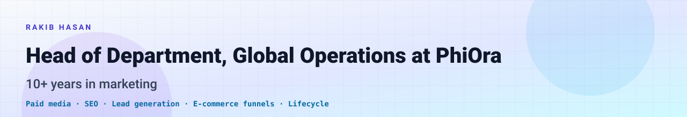

<!--
  Hello, recruiter / founder / CMO 👋
  Everything on this page is sourced from this GitHub account and my
  public profiles. Every claim carries a number; every CTA links to a
  public destination. If something feels off, message me on LinkedIn or
  WhatsApp.
-->

<picture>
  <source media="(prefers-color-scheme: dark)" srcset="./assets/banner.svg">
  
</picture>

 

# Hi, I'm **Rakib Hasan** 👋

### Head of Department, Global Operations at **PhiOra** — building self-hosted, AI-native growth systems.

Marketing leader with **10+ years** running paid media, SEO, lead generation, e-commerce funnels, and lifecycle programs across agency, startup, and group settings. I build the attribution and CPL / CPA discipline that connects spend to revenue.

 

  

📍 <b>Dhaka, Bangladesh</b> &nbsp;·&nbsp;
🌐 <b>Bengali</b> (native) · <b>English</b> (professional) &nbsp;·&nbsp;
💼 Available remotely for international teams · Open to relocation with visa sponsorship

 

## 📈 Selected results

<table>
  <thead>
    <tr>
      <th align="left">Brand</th>
      <th align="right">Result</th>
    </tr>
  </thead>
  <tbody>
    <tr><td><b>TCL Global</b></td><td align="right">Doubled B2C revenue in <b>6 months</b>; <b>2</b> new regional branches launched in 8 months</td></tr>
    <tr><td><b>LaserTreat</b></td><td align="right"><b>BDT 3.5–4 crore</b> monthly revenue on a USD 45K–50K monthly ad budget</td></tr>
    <tr><td><b>LaserTreat</b></td><td align="right"><b>30K+</b> / <b>10K+</b> / <b>20K+</b> / <b>100+</b> patient acquisitions across 4 business lines</td></tr>
    <tr><td><b>Praava Health</b></td><td align="right"><b>$54.26K+</b> MRR · <b>32K+</b> patient acquisitions</td></tr>
    <tr><td><b>BRAC Bank</b></td><td align="right"><b>$7.57M</b> revenue in a 3-week Eid campaign · 2.3M reach</td></tr>
    <tr><td><b>Pickaboo</b></td><td align="right"><b>20K+</b> phones sold through paid digital funnels</td></tr>
    <tr><td><b>Apex Footwear</b></td><td align="right"><b>2,240+</b> units sold at ROAS <b>7.47</b></td></tr>
    <tr><td><b>DBL Ceramics</b></td><td align="right"><b>1M+</b> sq ft of tiles sold online</td></tr>
    <tr><td><b>IFAD Autos</b></td><td align="right"><b>150+</b> commercial vehicles sold online (≈ BDT 250M revenue)</td></tr>
    <tr><td><b>Concord Real Estate</b></td><td align="right"><b>1K+</b> qualified leads</td></tr>
    <tr><td><b>GAIN</b></td><td align="right"><b>1.02M+</b> pledges from adolescents</td></tr>
    <tr><td><b>Anglo Eastern Glass</b></td><td align="right"><b>117K m³</b> of glass sold in Q1 (B2B)</td></tr>
    <tr><td><b>TECNO Mobile</b></td><td align="right"><b>300%</b> search volume increase in 3 days · <b>1M+</b> views on an interactive short film</td></tr>
    <tr><td><b>ASUS Zenfone Live</b></td><td align="right"><b>1.3M+</b> views</td></tr>
    <tr><td><b>MACES</b></td><td align="right"><b>1,700+</b> footfalls and <b>700+</b> qualified leads for the International Education Expo</td></tr>
    <tr><td><b>ActionAid Bangladesh</b></td><td align="right"><b>1.3M+</b> views on the 16 Days of Activism campaign video</td></tr>
    <tr><td><b>PhiOra</b></td><td align="right">Client-reported: <b>80%</b> lower software costs at LaserTreat; <b>1,000+</b> hours saved per year at Elyze Aesthetic Clinic</td></tr>
  </tbody>
</table>

 

## 🛠️ How I work with you

<table>
  <thead>
    <tr>
      <th align="left">Engagement</th>
      <th align="left">What you walk away with</th>
    </tr>
  </thead>
  <tbody>
    <tr>
      <td><b>Paid Media &amp; Performance</b> Meta · Google · LinkedIn</td>
      <td>Paid media run against weekly CPA / CPL benchmarks, with spend mapped back to CAC and LTV.</td>
    </tr>
    <tr>
      <td><b>Lead Gen, Funnels &amp; E-commerce CRO</b> ClickFunnels · Shopify · WordPress</td>
      <td>Lead-gen systems and conversion funnels, plus booking and checkout flows run with funnel-level CRO discipline.</td>
    </tr>
    <tr>
      <td><b>Attribution &amp; Analytics</b> Google Analytics · Looker Studio · Metabase · PostHog</td>
      <td>Advanced attribution models and reporting that connect spend to revenue.</td>
    </tr>
    <tr>
      <td><b>Automation &amp; AI Workflows</b> Zapier · n8n · Claude Code · OpenAI Codex</td>
      <td>PhiOra's 90-day build-and-handover: 3 systems, 65 deliverables, and 18 open-source services on the client's own servers, then ownership passes to the client's team.</td>
    </tr>
  </tbody>
</table>

 

## 🏢 Selected brands

  
  
  
  
  
  
  
  
  
  
  
  
  
  
  
  
  
  
  

 

## 🧰 Stack I work in

<table>
  <tr>
    <td valign="top" width="50%">

**Paid Media &amp; Social**

`Meta Ads` · `Google Ads` · `LinkedIn Ads` · `Revealbot` · `Meta Business Suite` · `Hootsuite` · `Buffer`

</td>
    <td valign="top" width="50%">

**Analytics &amp; Reporting**

`Google Analytics` · `Metabase` · `Mixpanel` · `PostHog` · `Looker Studio` · `Tableau`

</td>
  </tr>
  <tr>
    <td valign="top">

**Automation &amp; AI**

`Zapier` · `n8n` · `Claude Code` · `OpenAI Codex` · `OpenClaw` · `Hermes Agent` · `Agent Zero`

</td>
    <td valign="top">

**CRO, SEO &amp; Lifecycle**

`ClickFunnels` · `VWO` · `Google Optimize` · `Ubersuggest` · `SEMrush` · `Ahrefs` · `Mailchimp` · `Klaviyo` · `CleverTap`

</td>
  </tr>
  <tr>
    <td valign="top">

**Commerce &amp; CMS**

`Shopify` · `WordPress`

</td>
    <td valign="top">

**CRM &amp; Project Tools**

`HubSpot` · `Twenty` · `ClickUp` · `Notion` · `Trello`

</td>
  </tr>
</table>

 

## 🪜 Where I've been

| When | Role | Where |
|---|---|---|
| **Oct 2025 → Present** | Head of Department, **Global Operations** | **PhiOra** — AI-native growth partner for $10K+ MRR businesses; 90-day build-and-handover engagements |
| **Apr 2025 → Sep 2025** | Head of Department, **Global Marketing** | **TCL Global** — 35-member team, 21 branches, 14+ countries; doubled B2C revenue in 6 months |
| **Nov 2023 → Mar 2025** | Head of Department, Digital Marketing | **LaserTreat** — 12-member team, 4 business lines, USD 45–50K/mo ad spend |
| **Mar 2022 → Oct 2023** | Senior Manager, Digital Marketing | **Praava Health** — 30-member marketing team incl. 9-member telemarketing; USD 35–40K/mo Meta + Google budget |
| **Jul 2021 → Feb 2022** | Manager, Digital Marketing | **WebAble Digital** — 20-person team, 15+ corporate clients; Apex Footwear, GAIN, Suzuki, Concord |
| **Jan 2020 → Jun 2021** | Assistant Manager, Digital Marketing | **WebAble Digital** — IFAD Autos, MACES, ActionAid Bangladesh |
| **Jan 2019 → Dec 2019** | Senior Executive, Digital Marketing | **WebAble Digital** — Paid campaigns on Meta and Google: planning, billing, ROI tracking |
| **Mar 2017 → Dec 2018** | Executive, Business Development | **WebAble Digital** — Upsold digital marketing and B2B SaaS to local clients |

**Education:** BSc in Electrical & Electronic Engineering, BRAC University (2013–2016)

 

## 🏗️ Currently building

<b>Last 365 days — regenerated nightly.</b>

<picture>
  <source media="(prefers-color-scheme: dark)" srcset="https://raw.githubusercontent.com/spirispark/spirispark/output/github-contribution-grid-snake-dark.svg">
  
</picture>

 

<picture>
  <source media="(prefers-color-scheme: dark)" srcset="./assets/phiora-card.svg">
  
</picture>

 

---

## 🤝 Let's talk

If your attribution is fuzzy, your CPL / CPA keeps drifting, your team is buried in manual work, or growth has plateaued — I can help.

The fastest path is a quick DM on WhatsApp: tell me where growth is stuck and I'll reply.

 

📌 Last updated 2026 · <i>Helping CXOs with Systems, AI, and Marketing</i> · <i>Currently building PhiOra</i>
